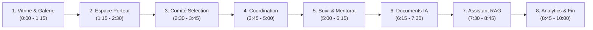

# Guide de Démonstration Officiel & Comptes de Test — CIAT

> **Plateforme Numérique du Centre d'Innovation, d'Application et de Transfert (CIAT)**  
> **Établissement :** Institut Supérieur d'Enseignement Professionnel (ISEP) Amadou Traoré de Diamniadio  
> **Auteurs & Destinataires :** Massogui Diop (Enregistrement vidéo), Lansana Coly (Démonstration jury & lead technique)  
> **Durée totale cible :** 8 à 10 minutes (ou version compacte 4 à 5 minutes pour la vidéo)  
> **Environnement :** Local uniquement (`localhost:8000` pour Django API, `localhost:3000` pour Next.js)  
> **Avertissement de conformité :** La plateforme n'est **pas déployée en production**. L'intégralité des données et des projets présentés sont **fictifs** et générés de façon déterministe via la commande `python manage.py seed_all`.

---

## 1. Comptes de Démonstration Vérifiés

Tous les comptes ci-dessous ont été créés via `seed_all` (et `seed_demo`), testés et vérifiés par appel direct à l'API d'authentification JWT (`/api/auth/token/` puis consultation du profil `/api/auth/me/`).

### 1.1 Comptes Équipe & Administration (Socle)

| Rôle Métier CIAT | Rôle Système API (`Role.*`) | Email vérifié | Mot de passe | Nom complet & Organisation | Droits & Accès Principaux | Écran de départ recommandé |
| :--- | :--- | :--- | :--- | :--- | :--- | :--- |
| **Administrateur Général** | `administrateur` (`ADMIN`) | `admin@ciat.sn` | `Ciat2026!` | Admin CIAT<br>*(ISEP Diamniadio)* | Accès complet, gestion des utilisateurs, validation/publication galerie, tableau de bord stratégique | `/tableau-de-bord` |
| **Coordonnateur de l'Incubateur** | `coordonnateur` (`COORDONNATEUR`) | `coordo@ciat.sn` | `Ciat2026!` | Coordonnateur CIAT<br>*(CIAT / Direction)* | Instruction des candidatures, décisions d'admission, affectation mentors, génération documents officiels IA | `/incubateur/projets` |
| **Membre du Comité de Sélection** | `membre_comite` (`COMITE`) | `comite@ciat.sn` | `Ciat2026!` | Membre Comité<br>*(Comité de Sélection)* | Consultation des dossiers soumis, notation sur grille multicritère à 5 critères, saisie d'avis d'experts | `/incubateur/evaluation` |
| **Mentor Référent** | `mentor` (`MENTOR`) | `mentor@ciat.sn` | `Ciat2026!` | Mentor CIAT<br>*(Réseau Mentorat Sénégal)* | Suivi des projets assignés, fixation des objectifs, validation des jalons et preuves, alertes retards | `/incubateur/projets` |
| **Porteur de Projet (Candidat socle)** | `porteur` (`PORTEUR`) | `porteur@ciat.sn` | `Ciat2026!` | Porteur Projet<br>*(Startup Demo)* | Espace candidat, soumission de projet, téléversement des pièces PDF obligatoires, accusé de réception | `/incubateur` |

### 1.2 Porteurs de Démonstration Réalistes (Échantillon parmi les 40 porteurs)

Le fichier `seed_all` génère 40 porteurs fictifs réalistes (`porteur01@demo.ciat.sn` à `porteur40@demo.ciat.sn`) avec le même mot de passe unifié `Ciat2026!`. Voici les profils les plus utiles pour illustrer les différents statuts lors de la démonstration :

| Identifiant | Porteur & Organisation | Statut du Projet associé | Projet Démo Clé | Domaine |
| :--- | :--- | :--- | :--- | :--- |
| `porteur01@demo.ciat.sn` | **Aminata Diallo**<br>*(AgriTech Sahel)* | **Terminé** (Projet phare en vitrine) | *SunuAgri AI — Détection des maladies maraîchères des Niayes* | TIC & Données |
| `porteur02@demo.ciat.sn` | **Fatou Ndiaye**<br>*(Solaire Sunu Kër)* | **Incubé** (Suivi jalons & preuves) | *Solaire Sunu Kër — Kits solaires modulaires* | Énergie |
| `porteur25@demo.ciat.sn` | **Alioune Sylla**<br>*(FabLab Diamniadio Proto)* | **Prototype** (Fiche galerie en validation) | *FabLab Diamniadio Proto — Prototypage rapide outillage* | Mécanique |
| `porteur26@demo.ciat.sn` | **Lamine Badji**<br>*(Ziguinchor AgroSolar)* | **Soumis** (Dossier complet en attente) | *Ziguinchor AgroSolar — Séchoirs solaires connectés* | Agriculture |
| `porteur32@demo.ciat.sn` | **Mansour Niang**<br>*(Diagnostic Laitier Dahra)* | **En évaluation** (Assigné au comité) | *Diagnostic Laitier Dahra — Analyse qualité du lait* | Pharmaceutique / Agro |

> [!IMPORTANT]
> **Règle de limitation de débit (Anti force-brute) :**  
> L'API applique une limitation stricte sur `/api/auth/token/` (`AuthRateThrottle: 5/min`). Si vous vous connectez et déconnectez plus de 5 fois en moins d'une minute sur la même machine, l'API renverra un code `HTTP 429 Too Many Requests`. Attendez 60 secondes ou utilisez des sessions de navigation privées différentes pour chaque rôle.

---

## 2. Préparation Rapide Avant Démonstration

Pour repartir d'un environnement propre, synchronisé et totalement cohérent :

```bash
# 1. Se positionner dans le dossier backend
cd backend

# 2. Réinitialiser la base de données avec toutes les données de test cohérentes
# (Commande 100 % idempotente, exécution en ~8 secondes)
.\.venv\Scripts\python.exe manage.py seed_all

# 3. Lancer le serveur backend Django (Port 8000)
.\.venv\Scripts\python.exe manage.py runserver 8000
```

Dans un second terminal :
```bash
# 4. Se positionner dans le dossier frontend
cd frontend

# 5. Démarrer le serveur Next.js (Port 3000)
npm run dev
```

### Onglets recommandés à ouvrir avant l'enregistrement (Navigateur en plein écran F11) :
1. **Onglet 1 (Public) :** `http://localhost:3000/` (Accueil institutionnel & Hero ISEP)
2. **Onglet 2 (Public) :** `http://localhost:3000/galerie` (Galerie publique des innovations)
3. **Onglet 3 (Porteur) :** `http://localhost:3000/connexion` (Pour connexion `porteur@ciat.sn`)
4. **Onglet 4 (Comité) :** `http://localhost:3000/incubateur/evaluation` (Grille multicritère)
5. **Onglet 5 (Coordonnateur) :** `http://localhost:3000/incubateur/projets` (Instruction & décision)
6. **Onglet 6 (Documents) :** `http://localhost:3000/documents` (Générateur documentaire officiel)
7. **Onglet 7 (Assistant RAG) :** `http://localhost:3000/assistant` (Assistant IA souverain)
8. **Onglet 8 (Direction) :** `http://localhost:3000/tableau-de-bord` (Analytics décisionnels)

---

## 3. Déroulé Chronologique Détaillé (8 à 10 minutes)



---

### Étape 1 : Vitrine Institutionnelle & Galerie des Innovations
* **Chronomètre :** `0:00` à `1:15` (1 min 15 s)
* **Acteur :** Visiteur externe / Jury public (Non connecté)
* **URL :** `http://localhost:3000/` puis `http://localhost:3000/galerie`
* **Action :**
  1. Parcourir la page d'accueil : mise en valeur de la charte graphique CIAT 360 (Brun, Ocre doré, Sable doux), photographie officielle du campus ISEP Diamniadio et présentation des 7 domaines technologiques.
  2. Cliquer sur l'onglet **Galerie** : naviguer parmi les fiches d'innovations validées et publiées.
  3. Ouvrir la fiche détaillée du projet phare : `SunuAgri AI — Détection des maladies maraîchères des Niayes` (`/galerie/sunuagri-ai-detection-des-maladies-maracheres-des-niayes`).
* **Résultat attendu :**
  - Affichage des images de démonstration générées localement (aucun appel externe, aucun lien brisé).
  - Badge de statut certifié (`Terminé` ou `Prototype`).
  - QR Code officiel généré à la volée pointant vers l'URL publique de la fiche.
  - Compteur de consultations certifié avec protection anti-triche (incrément unique par session).
* **Argumentaire à l'oral (Lansana / Massogui) :**
  > *« La plateforme valorise immédiatement les innovations issues de l'ISEP de Diamniadio et des territoires sénégalais. La galerie publique permet aux industriels, investisseurs et partenaires institutionnels de découvrir les prototypes viables avec une traçabilité complète et des visuels hébergés en toute souveraineté. »*

---

### Étape 2 : Espace Porteur — Candidature, Complétude & Accusé de Réception
* **Chronomètre :** `1:15` à `2:30` (1 min 15 s)
* **Acteur :** `porteur@ciat.sn` / `Ciat2026!`
* **URL :** `http://localhost:3000/connexion` puis `http://localhost:3000/incubateur`
* **Action :**
  1. Se connecter avec les identifiants du porteur.
  2. Accéder au dossier de candidature du projet (ou création d'un projet test dans le domaine AgriTech/Énergie).
  3. Vérifier le suivi des pièces obligatoires :
     - *Fiche de projet* (PDF)
     - *Présentation de l'équipe* (PDF)
     - *Budget prévisionnel* (PDF)
  4. Téléverser une pièce PDF justificative et cliquer sur **Soumettre officiellement mon dossier**.
  5. Télécharger l'accusé de réception officiel généré par la plateforme.
* **Résultat attendu :**
  - Contrôle strict côté serveur : refus des fichiers non-PDF et des extensions masquées (vérification de la signature magique `%PDF-`).
  - Blocage de la soumission tant que les 3 pièces obligatoires ne sont pas complètes.
  - Bascule immédiate du statut en `Soumis`.
  - Génération de l'accusé de réception PDF officiel comportant le numéro de dossier, la date et l'heure certifiées.
* **Argumentaire à l'oral :**
  > *« Le porteur bénéficie d'un guichet numérique ergonomique. Le système garantit la complétude formelle du dossier avant tout examen : impossible d'engorger le comité avec des dossiers incomplets. L'accusé de réception délivré protège juridiquement le candidat. »*

---

### Étape 3 : Comité de Sélection — Évaluation Multicritère sur Grille Standard
* **Chronomètre :** `2:30` à `3:45` (1 min 15 s)
* **Acteur :** `comite@ciat.sn` / `Ciat2026!`
* **URL :** `http://localhost:3000/connexion` puis `http://localhost:3000/incubateur/evaluation`
* **Action :**
  1. Se connecter en tant que membre du comité d'évaluation.
  2. Ouvrir la liste des dossiers assignés et sélectionner un dossier en attente d'évaluation (ex: *Diagnostic Laitier Dahra*).
  3. Remplir la **Grille standard de sélection CIAT** composée de 5 critères pondérés :
     - *1. Pertinence du problème et adéquation de la solution* (Note / 20)
     - *2. Caractère innovant et faisabilité technique* (Note / 20)
     - *3. Modèle économique et viabilité financière* (Note / 20)
     - *4. Compétences, profil et complémentarité de l'équipe* (Note / 20)
     - *5. Impact socio-économique, création de valeur et durabilité* (Note / 20)
  4. Saisir l'avis argumenté d'évaluation et enregistrer.
* **Résultat attendu :**
  - Calcul dynamique et automatique de la note moyenne pondérée sur 20.
  - Enregistrement atomique de l'évaluation avec horodatage et identité de l'évaluateur.
  - Impossibilité pour un porteur d'accéder à cette interface (contrôle d'accès RBAC étanche).
* **Argumentaire à l'oral :**
  > *« Les évaluations sont collégiales, objectives et standardisées. Les 5 critères garantissent que l'innovation technique ne masque pas la viabilité économique ou l'impact territorial, particulièrement sur l'emploi des jeunes et des femmes. »*

---

### Étape 4 : Coordination de l'Incubateur — Décision Motivée & Affectation du Mentor
* **Chronomètre :** `3:45` à `5:00` (1 min 15 s)
* **Acteur :** `coordo@ciat.sn` / `Ciat2026!`
* **URL :** `http://localhost:3000/incubateur/projets`
* **Action :**
  1. Se connecter en tant que coordonnateur du CIAT.
  2. Consulter la synthèse des évaluations et des notes attribuées par le comité sur le dossier instruit.
  3. Formaliser la décision d'admission :
     - Sélectionner la décision : **Accepté**
     - Saisir le motif officiel : *« Projet hautement stratégique pour le bassin maraîcher, prototype validé par le comité technique. »*
  4. Valider la décision : le dossier passe en `Accepté` et le projet en `Sélectionné`.
  5. Affecter le mentor référent : sélectionner `mentor@ciat.sn` (*Mentor CIAT*).
* **Résultat attendu :**
  - Mise à jour synchronisée en base entre le modèle `Dossier` et le modèle `Projet`.
  - Notification interne et déblocage de l'espace d'incubation pour le projet.
  - Enregistrement de l'auteur de la décision dans le journal d'audit.
* **Argumentaire à l'oral :**
  > *« Le coordonnateur centralise les avis des experts et prend une décision souveraine et motivée. L'affectation immédiate d'un mentor qualifié scelle le début du parcours d'accélération au sein des ateliers de l'ISEP. »*

---

### Étape 5 : Suivi Opérationnel & Mentorat — Jalons, Preuves & Alertes Retards
* **Chronomètre :** `5:00` à `6:15` (1 min 15 s)
* **Acteur :** `mentor@ciat.sn` / `Ciat2026!`
* **URL :** `http://localhost:3000/incubateur/projets` puis onglet Jalons / Alertes
* **Action :**
  1. Se connecter avec le compte mentor.
  2. Ouvrir le tableau de bord du projet suivi (ex: *Solaire Sunu Kër* ou *SunuAgri AI*).
  3. Consulter les objectifs fixés et la chronologie des jalons d'avancement.
  4. Afficher un jalon complété : visualiser la pièce de preuve technique téléversée.
  5. Ajouter un commentaire d'accompagnement horodaté sur un jalon en cours.
  6. Naviguer vers la vue **Alertes de l'incubateur** (`/incubateur/alertes`).
* **Résultat attendu :**
  - Détection automatique et calcul en temps réel des jalons en retard (`en_retard = True` si date dépassée et statut non fait).
  - Indicateurs visuels explicites (drapeau orange si retard < 15 jours, drapeau rouge d'alerte critique si > 15 jours).
  - Historique inaltérable des échanges mentor/porteur.
* **Argumentaire à l'oral :**
  > *« L'incubation ne se résume pas à des promesses : elle repose sur des jalons vérifiables avec preuves techniques. Le système d'alerte permet à la coordination d'intervenir dès qu'un projet décroche, prévenant l'échec entrepreneurial. »*

---

### Étape 6 : Moteur Documentaire Officiel IA — Génération, Versionnage & Export PDF
* **Chronomètre :** `6:15` à `7:30` (1 min 15 s)
* **Acteur :** `coordo@ciat.sn` / `Ciat2026!` (ou `admin@ciat.sn`)
* **URL :** `http://localhost:3000/documents`
* **Action :**
  1. Se rendre dans le module Documents.
  2. Choisir un modèle officiel parmi les 12 disponibles : sélectionner **Convention d'incubation CIAT — Format Standard / Engagement Bilatéral**.
  3. Associer le projet cible (ex: *SunuAgri AI*).
  4. Cliquer sur **Générer le document** (ou prévisualiser le prompt structuré avec variables injectées).
  5. Montrer l'historique des versions (v1, v2) permettant d'amender les clauses sans perdre l'antériorité.
  6. Cliquer sur **Exporter en PDF officiel**.
* **Résultat attendu :**
  - Injection automatique des données réelles du projet dans les sections contractuelles.
  - Respect scrupuleux des directives de la charte éditoriale ISEP Diamniadio.
  - Téléchargement d'un document PDF prêt à l'impression avec en-tête officiel, numérotation de version et espaces de signature.
* **Argumentaire à l'oral :**
  > *« Rédiger des conventions d'incubation ou des fiches techniques prend habituellement des jours. Grâce à notre moteur documentaire IA paramétré sur nos modèles légaux, l'équipe génère en quelques secondes des actes conformes à la charte institutionnelle, versionnés et prêts à signer. »*

---

### Étape 7 : Assistant IA Souverain — RAG Documentaire Strict & Refus Anti-Hallucination
* **Chronomètre :** `7:30` à `8:45` (1 min 15 s)
* **Acteur :** Utilisateur connecté (ex: `coordo@ciat.sn` ou `porteur@ciat.sn`)
* **URL :** `http://localhost:3000/assistant`
* **Action :**
  1. Ouvrir l'Assistant IA conversationnel.
  2. **Test 1 (Question couverte par la base documentaire) :**  
     Poser la question :  
     *« Quels sont les documents publics disponibles et quelles sont les conditions d'accès aux ateliers ? »*  
     -> Observer la réponse circonstanciée citant les passages exacts du *Règlement Intérieur de l'Incubateur* avec les liens vers les documents sources.
  3. **Test 2 (Question piège — Épreuve de vérité anti-hallucination) :**  
     Poser la question :  
     *« Quel est le montant exact de la subvention financière directe versée aux startups ? »*  
     -> Observer la réponse : l'assistant affirme en toute transparence que l'information n'est pas stipulée dans le corpus documentaire fourni, et le bloc des sources reste **strictement vide**.
* **Résultat attendu :**
  - Contrôle JSON strict côté serveur (`ai.chat(..., json_mode=True)`).
  - Validation que les numéros de passages cités existent réellement parmi les extraits transmis.
  - Filtrage total : aucune source affichée lorsque le modèle n'a pas utilisé d'extrait ou refuse de répondre.
  - Zéro hallucination, souveraineté totale du corpus CIAT.
* **Argumentaire à l'oral :**
  > *« Contrairement aux IA génériques qui inventent des informations financières pour plaire à l'utilisateur, notre assistant RAG applique un filtrage strict côté serveur. S'il ne trouve pas l'information dans les textes réglementaires du CIAT, il refuse poliment et n'affiche aucune source trompeuse. C'est le gage d'une IA souveraine et digne de confiance. »*

---

### Étape 8 : Tableau de Bord Stratégique, Parité & Conclusion
* **Chronomètre :** `8:45` à `10:00` (1 min 15 s)
* **Acteur :** `admin@ciat.sn` / `Ciat2026!`
* **URL :** `http://localhost:3000/tableau-de-bord` et `http://localhost:3000/tableau-de-bord/methodologie`
* **Action :**
  1. Se connecter avec le compte administrateur.
  2. Présenter la vue d'ensemble décisionnelle :
     - Volume de projets accompagnés : **63 projets réalistes**
     - Financements mobilisés : **467,5 millions FCFA** (subventions, concours, partenaires)
     - Taux de féminisation des porteurs : **37,2 %** (atteinte de l'objectif parité 35-40 %)
  3. Actionner les filtres interactifs : filtrer par cohorte (*Cohorte 2026*) puis par domaine (*TIC* ou *Agriculture*).
  4. Ouvrir l'onglet **Méthodologie** (`/tableau-de-bord/methodologie`) : montrer la rigueur de définition de chaque indicateur pour les bailleurs de fonds.
  5. Déclencher un export des indicateurs (Excel ou PDF).
* **Résultat attendu :**
  - Graphiques dynamiques réactifs aux filtres sans rechargement lourd.
  - Répartition par domaine et pyramide des statuts rigoureusement alignées sur la base de données.
  - Documentation méthodologique accessible en un clic pour les auditeurs.
* **Argumentaire à l'oral (Conclusion de Lansana) :**
  > *« En résumé, la plateforme du CIAT de l'ISEP Diamniadio offre une réponse technologique complète, souveraine et robuste : de l'idée brute au prototype valorisé en galerie, avec un accompagnement rigoureux par les pairs, une conformité documentaire automatisée et un pilotage décisionnel transparent. Tous les tests sont validés, les flux de travail sont hermétiques et les données locales sont prêtes pour l'évaluation. »*

---

## 4. Fiche Récapitulative des Écrans et Comptes pour le Tournage

| Chrono | Écran / URL | Compte Démo | Action Clé | Résultat à capturer |
| :--- | :--- | :--- | :--- | :--- |
| `0:00 - 1:15` | `/galerie` | *Public (Non connecté)* | Survol des prototypes, clic sur *SunuAgri AI* | Photos locales, QR Code, compteur de vues |
| `1:15 - 2:30` | `/incubateur` | `porteur@ciat.sn` | Dépôt PDF 3 pièces, soumission dossier | Statut soumis, téléchargement accusé PDF |
| `2:30 - 3:45` | `/incubateur/evaluation` | `comite@ciat.sn` | Notation 5 critères sur grille standard | Calcul note sur 20, avis motivé enregistré |
| `3:45 - 5:00` | `/incubateur/projets` | `coordo@ciat.sn` | Décision d'acceptation, affectation mentor | Statut projet « Sélectionné », mentor lié |
| `5:00 - 6:15` | `/incubateur/alertes` | `mentor@ciat.sn` | Dépôt preuve jalon, alerte retard critique | Badge rouge retard > 15j, journal horodaté |
| `6:15 - 7:30` | `/documents` | `coordo@ciat.sn` | Génération convention, export PDF | PDF officiel conforme charte 360 |
| `7:30 - 8:45` | `/assistant` | `porteur@ciat.sn` | Question réglementaire + question refus | Sources citées vs sources vides (anti-hallucination) |
| `8:45 - 10:00` | `/tableau-de-bord` | `admin@ciat.sn` | Filtres cohortes, parité 37.2%, méthodologie | Graphiques interactifs, export de données |

---

## 5. Dépannage Rapide & Bonnes Pratiques du Démonstrateur

### 5.1 Erreur `429 Too Many Requests`
- **Cause :** Plus de 5 tentatives de connexion effectuées en moins d'une minute (`AuthRateThrottle`).
- **Solution immédiate :** Patienter 60 secondes sans rafraîchir la page, ou ouvrir une fenêtre de navigation privée distincte.

### 5.2 Les médias ou images semblent indisponibles
- **Cause :** Le serveur backend Django n'est pas lancé ou `NEXT_PUBLIC_API_URL` pointe sur un mauvais port.
- **Vérification :** S'assurer que le backend écoute sur `http://localhost:8000` et tester `http://localhost:8000/api/health/`. Le proxy média du frontend route automatiquement `/media/*` vers le backend configuré.

### 5.3 En cas de perturbation de l'accès internet pendant la démo
- **Robustesse native :**
  - Toutes les données et images sont **100 % locales** (aucun CDN bloquant, polices embarquées, images Pillow générées en local).
  - Le RAG documentaire et l'extraction de texte fonctionnent avec des passages indexés en base SQLite locale.
  - Si aucune clé d'IA distante n'est fournie, le moteur documentaire utilise les gabarits de secours rédigés et l'assistant applique le message institutionnel sécurisé sans planter.

---

> **Document validé pour la Phase 5 (Tâche T1).**  
> Prêt pour l'enregistrement vidéo de Massogui et les répétitions de soutenance de Lansana.
