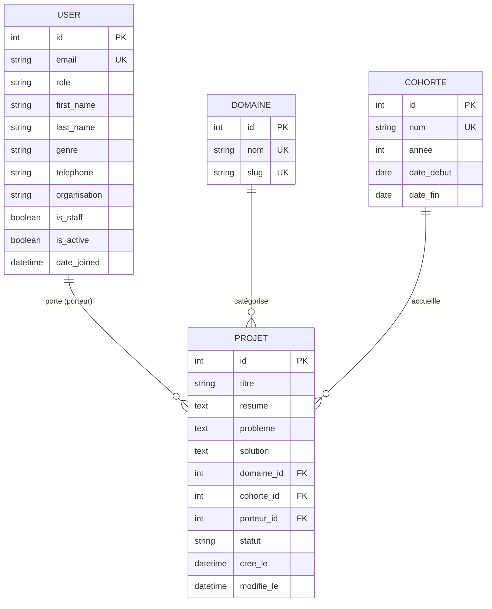
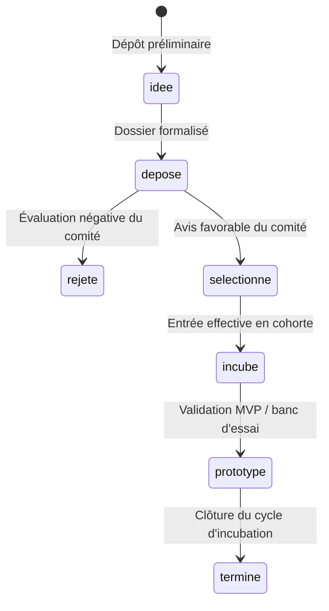

# Dictionnaire des Données — Plateforme CIAT

> **Centre d'Innovation, d'Application et de Transfert (ISEP Amadou Traoré, Diamniadio)**  
> **Avertissement :** Les données de démonstration peuplées par la commande `seed_demo` sont **strictement fictives**. Les adresses électroniques en `@demo.ciat.sn`, les numéros de téléphone, les identités de personnes, les intitulés de projets et les organisations associées ont été créés pour les besoins de validation technique, d'évaluation ergonomique et de démonstration du jury. Aucune donnée personnelle réelle n'est présente dans la base.

---

## 1. Vue d'ensemble du Modèle Conceptuel de Données

Le socle commun (`apps/core`) gère l'authentification unifiée, le contrôle d'accès par rôle, ainsi que le référentiel transverse partagé par tous les modules métiers (incubateur, portail, documents, analytics, assistant, galerie).

---

## 2. Modèle `User` (Utilisateurs et Rôles)

- **Application :** `apps.core.models.User`
- **Table base de données :** `core_user`
- **Description :** Utilisateurs de la plateforme identifiés de manière unique par leur adresse email. Le rôle attribué détermine l'ensemble des permissions fonctionnelles et des accès aux endpoints d'API.

| Nom du champ | Type Django | Null / Blank | Valeurs possibles / Contraintes | Signification / Description métier |
|---|---|---|---|---|
| `id` | `BigAutoField` | Non / Non | Entier positif auto-incrémenté (Clé primaire) | Identifiant unique interne de l'utilisateur. |
| `email` | `EmailField` | Non / Non | Chaîne email valide, unique sur toute la base | Adresse de connexion (remplace le champ `username` standard). |
| `password` | `CharField` (max 128) | Non / Non | Chaîne chiffrée (PBKDF2/Argon2) | Empreinte sécurisée du mot de passe de l'utilisateur. |
| `role` | `CharField` (max 20) | Non / Non | `administrateur`, `coordonnateur`, `mentor`, `membre_comite`, `porteur`, `visiteur`. Défaut : `porteur` | Rôle régissant les droits d'accès RBAC sur toute la plateforme. |
| `first_name` | `CharField` (max 150) | Non / Oui | Chaîne de caractères alphabétiques | Prénom usuel de l'utilisateur. |
| `last_name` | `CharField` (max 150) | Non / Oui | Chaîne de caractères alphabétiques | Nom de famille de l'utilisateur. |
| `genre` | `CharField` (max 1) | Non / Oui | `F` (Femme), `H` (Homme), `A` (Autre / non précisé). Défaut : `""` | Genre pour le suivi statistique et la parité dans les cohortes. |
| `telephone` | `CharField` (max 30) | Non / Oui | Format international recommandé (`+221...`) | Numéro de contact téléphonique direct. |
| `organisation` | `CharField` (max 150) | Non / Oui | Chaîne libre (entreprise, coopérative, école) | Structure, établissement ou entité d'appartenance. |
| `is_active` | `BooleanField` | Non / Non | `True`, `False`. Défaut : `True` | Indique si le compte est autorisé à s'authentifier. |
| `is_staff` | `BooleanField` | Non / Non | `True`, `False`. Défaut : `False` | Accès autorisé à l'interface d'administration Django (`/admin/`). |
| `is_superuser` | `BooleanField` | Non / Non | `True`, `False`. Défaut : `False` | Octroie toutes les permissions de super-utilisateur sans assignation explicite. |
| `last_login` | `DateTimeField` | Oui / Oui | Date & heure ISO 8601 | Horodatage de la dernière session réussie. |
| `date_joined` | `DateTimeField` | Non / Non | Date & heure courante par défaut | Horodatage de création du compte utilisateur. |

---

## 3. Modèle `Domaine` (Pôles d'intervention technologique)

- **Application :** `apps.core.models.Domaine`
- **Table base de données :** `core_domaine`
- **Description :** Filières techniques et thématiques prioritaires de l'ISEP Diamniadio et du CIAT.

| Nom du champ | Type Django | Null / Blank | Valeurs possibles / Contraintes | Signification / Description métier |
|---|---|---|---|---|
| `id` | `BigAutoField` | Non / Non | Entier positif auto-incrémenté (Clé primaire) | Identifiant unique interne du domaine. |
| `nom` | `CharField` (max 120) | Non / Non | Unique. 7 libellés officiels définis pour le CIAT | Libellé complet de la filière technologique. |
| `slug` | `SlugField` (max 140) | Non / Oui | Unique. Généré automatiquement depuis `nom` | Identifiant textuel normalisé pour les URLs et filtres d'API. |

### Liste des 7 domaines officiels du CIAT
1. `TIC, numérique, intelligence artificielle et données`
2. `Mécanique, fabrication et maintenance`
3. `Agriculture, transformation et environnement`
4. `Énergie, efficacité énergétique et énergies renouvelables`
5. `Pharmaceutique et biomédical`
6. `Éducation, formation professionnelle et insertion`
7. `Services aux collectivités, entrepreneuriat et incubation`

---

## 4. Modèle `Cohorte` (Promotions d'incubation)

- **Application :** `apps.core.models.Cohorte`
- **Table base de données :** `core_cohorte`
- **Description :** Promotions annuelles d'incubation et d'accélération accueillant les porteurs de projet.

| Nom du champ | Type Django | Null / Blank | Valeurs possibles / Contraintes | Signification / Description métier |
|---|---|---|---|---|
| `id` | `BigAutoField` | Non / Non | Entier positif auto-incrémenté (Clé primaire) | Identifiant unique interne de la cohorte. |
| `nom` | `CharField` (max 120) | Non / Non | Unique (ex. : `Cohorte 2024`, `Cohorte 2025`, `Cohorte 2026`) | Nom usuel de la promotion. |
| `annee` | `PositiveSmallIntegerField` | Non / Non | Année sur 4 chiffres (ex. : `2024`, `2025`, `2026`) | Année calendaire de rattachement de la promotion. |
| `date_debut` | `DateField` | Oui / Oui | Date `AAAA-MM-JJ` | Date de lancement officiel du cycle d'incubation. |
| `date_fin` | `DateField` | Oui / Oui | Date `AAAA-MM-JJ` | Date de clôture ou démo day de la promotion. |

---

## 5. Modèle `Projet` (Projets et Startups incubés)

- **Application :** `apps.core.models.Projet`
- **Table base de données :** `core_projet`
- **Description :** Cœur informationnel de la plateforme. Représente l'innovation développée, son problème cible, la solution apportée, son porteur, son domaine et son état d'avancement.

| Nom du champ | Type Django | Null / Blank | Valeurs possibles / Contraintes | Signification / Description métier |
|---|---|---|---|---|
| `id` | `BigAutoField` | Non / Non | Entier positif auto-incrémenté (Clé primaire) | Identifiant unique du projet. |
| `titre` | `CharField` (max 200) | Non / Non | Chaîne textuelle descriptive | Nom ou intitulé du projet innovant. |
| `resume` | `TextField` | Non / Oui | Texte libre | Synthèse exécutive du projet (1 à 3 paragraphes). |
| `probleme` | `TextField` | Non / Oui | Texte libre | Diagnostic du besoin marché ou de la problématique locale résolue. |
| `solution` | `TextField` | Non / Oui | Texte libre | Description technique et économique de l'innovation proposée. |
| `domaine` | `ForeignKey(Domaine)` | Non / Non | Clé étrangère vers `Domaine`, `on_delete=PROTECT` | Domaine technologique de rattachement. |
| `cohorte` | `ForeignKey(Cohorte)` | Oui / Oui | Clé étrangère vers `Cohorte`, `on_delete=SET_NULL` | Promotion d'incubation (facultatif si projet à l'état d'idée préliminaire). |
| `porteur` | `ForeignKey(User)` | Non / Non | Clé étrangère vers `User`, `on_delete=PROTECT` | Utilisateur responsable du projet. |
| `statut` | `CharField` (max 20) | Non / Non | Valeurs de `Projet.Statut` (voir cycle ci-après). Défaut : `idee` | Étape courante du projet dans le pipeline CIAT. |
| `cree_le` | `DateTimeField` | Non / Non | Date & heure (`auto_now_add=True`) | Horodatage de création initiale du projet. |
| `modifie_le` | `DateTimeField` | Non / Non | Date & heure (`auto_now=True`) | Horodatage de dernière modification de la fiche projet. |

### Cycle de vie d'un projet (`Projet.Statut`)

1. `idee` : Idée préliminaire non encore instruite en comité.
2. `depose` : Candidature formelle déposée avec pièces justificatives.
3. `selectionne` : Projet retenu par le comité de sélection après instruction.
4. `incube` : Projet en cours d'accompagnement actif au sein du CIAT.
5. `prototype` : Prototype fonctionnel ou preuve de concept technique validée au FabLab.
6. `termine` : Cycle d'incubation achevé avec succès (prêt au déploiement marché).
7. `rejete` : Projet non retenu par le comité de sélection.

---

## 6. Répartition et Volumétrie des Données de Démonstration (`seed_demo`)

Le jeu de démonstration génère automatiquement :
- **62 projets réalistes** ancrés dans le contexte territorial sénégalais (Niayes, Casamance, Vallée du Fleuve, Saloum, Dakar/Diamniadio).
- **Majorité avancée :** ~77 % des projets se situent dans les statuts actifs ou finalisés (`selectionne`, `incube`, `prototype`, `termine`).
- **42 porteurs de projets :** avec une parité de **38 % à 40 % de femmes**.
- **Étalement temporel :** Dates de création réparties sur 18 mois pour permettre des graphiques réalistes dans le tableau de bord décisionnel (P3 Analytics).
