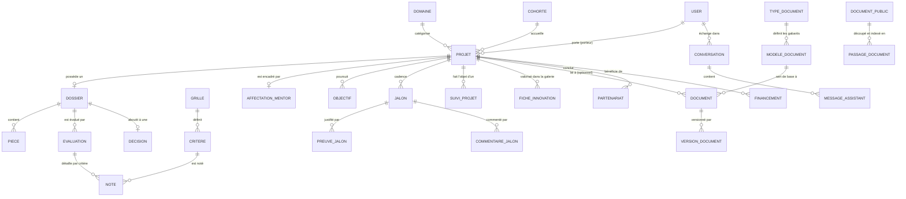

# Dictionnaire des Données — Plateforme CIAT

> **Centre d'Innovation, d'Application et de Transfert (ISEP Amadou Traoré, Diamniadio)**  
> **Avertissement :** Les données de démonstration peuplées par la commande `seed_all` (et `seed_demo`) sont **strictement fictives**. Les adresses électroniques en `@demo.ciat.sn`, les numéros de téléphone, les identités de personnes, les intitulés de projets et les organisations associées ont été créés pour les besoins de validation technique, d'évaluation ergonomique et de démonstration du jury. Aucune donnée personnelle réelle n'est présente dans la base.

---

## 1. Vue d'ensemble du Modèle Conceptuel de Données

Le socle commun (`apps.core`) gère l'authentification unifiée, le contrôle d'accès par rôle (RBAC), ainsi que le référentiel transverse partagé par tous les modules métiers (incubateur, portail, documents, analytics, assistant, galerie).

---

## 2. Socle Commun (`apps.core`)

### 2.1 Modèle `User` (Utilisateurs et Rôles)
- **Table :** `core_user` | **Description :** Utilisateurs identifiés par email unique avec contrôle RBAC strict.

| Champ | Type Django | Contraintes | Description |
|---|---|---|---|
| `id` | `BigAutoField` | PK, Not Null | Identifiant unique de l'utilisateur. |
| `email` | `EmailField` | Unique, Not Null | Identifiant de connexion principal. |
| `password` | `CharField(128)` | Not Null | Empreinte chiffrée (PBKDF2/MD5 pour les tests). |
| `role` | `CharField(20)` | Not Null | `administrateur`, `coordonnateur`, `mentor`, `membre_comite`, `porteur`, `visiteur`. Défaut : `porteur`. |
| `first_name` | `CharField(150)` | Blank | Prénom de l'utilisateur. |
| `last_name` | `CharField(150)` | Blank | Nom de famille. |
| `genre` | `CharField(1)` | Choices (`F`, `H`, `A`) | Code canonique à 1 caractère pour le suivi de parité. |
| `telephone` | `CharField(30)` | Blank | Coordonnées téléphoniques directes. |
| `organisation` | `CharField(150)` | Blank | Établissement, laboratoire, entreprise ou coopérative. |
| `is_active` | `BooleanField` | Défaut: True | Compte actif pouvant se connecter. |
| `is_staff` | `BooleanField` | Défaut: False | Droit d'accès à l'administration Django `/admin/`. |
| `date_joined` | `DateTimeField` | Auto now add | Date et heure de création du compte. |

### 2.2 Modèle `Domaine` (Pôles technologiques)
- **Table :** `core_domaine` | **Description :** Les 7 domaines prioritaires d'intervention technologique du CIAT.

| Champ | Type Django | Contraintes | Description |
|---|---|---|---|
| `id` | `BigAutoField` | PK, Not Null | Identifiant unique du domaine. |
| `nom` | `CharField(120)` | Unique, Not Null | Intitulé officiel de la filière technologique. |
| `slug` | `SlugField(140)` | Unique, Blank | Identifiant textuel normalisé pour les URLs et filtres. |

### 2.3 Modèle `Cohorte` (Promotions d'incubation)
- **Table :** `core_cohorte` | **Description :** Promotions annuelles d'incubation et d'accélération.

| Champ | Type Django | Contraintes | Description |
|---|---|---|---|
| `id` | `BigAutoField` | PK, Not Null | Identifiant unique de la cohorte. |
| `nom` | `CharField(120)` | Unique, Not Null | Nom usuel (ex: *Cohorte 2024*, *Cohorte 2025*, *Cohorte 2026*). |
| `annee` | `PositiveSmallIntegerField` | Not Null | Année calendaire de rattachement. |
| `date_debut` | `DateField` | Null, Blank | Date de démarrage officiel du cycle d'incubation. |
| `date_fin` | `DateField` | Null, Blank | Date d'évaluation finale ou démo-day. |

### 2.4 Modèle `Projet` (Projets innovants)
- **Table :** `core_projet` | **Description :** Entité pivot représentant l'innovation technologique instruite et incubée.

| Champ | Type Django | Contraintes | Description |
|---|---|---|---|
| `id` | `BigAutoField` | PK, Not Null | Identifiant unique du projet. |
| `titre` | `CharField(200)` | Not Null | Intitulé du projet innovant. |
| `resume` | `TextField` | Blank | Synthèse exécutive du projet. |
| `probleme` | `TextField` | Blank | Diagnostic du besoin marché ou problème adressé. |
| `solution` | `TextField` | Blank | Solution technique et fonctionnelle proposée. |
| `domaine` | `ForeignKey(Domaine)` | PROTECT, Not Null | Pôle technologique de rattachement. |
| `cohorte` | `ForeignKey(Cohorte)` | SET_NULL, Null, Blank | Promotion d'incubation associée. |
| `porteur` | `ForeignKey(User)` | PROTECT, Not Null | Porteur titulaire du projet. |
| `statut` | `CharField(20)` | Choices, Défaut: `idee` | Statuts : `idee`, `depose`, `selectionne`, `incube`, `prototype`, `termine`, `rejete`. |
| `cree_le` | `DateTimeField` | Auto now add | Horodatage de création initiale. |
| `modifie_le` | `DateTimeField` | Auto now | Horodatage de dernière mise à jour. |

---

## 3. Module Portail Institutionnel (`apps.portal`)

### 3.1 Modèle `Actualite`
- **Table :** `portal_actualite` | **Description :** Articles et dépêches d'information publique.

| Champ | Type Django | Contraintes | Description |
|---|---|---|---|
| `id` | `BigAutoField` | PK, Not Null | Identifiant unique. |
| `titre` | `CharField(200)` | Not Null | Titre éditorial de l'article. |
| `slug` | `SlugField(220)` | Unique, Blank | Slug URL généré automatiquement. |
| `resume` | `TextField` | Blank | Chapô ou résumé d'introduction. |
| `contenu` | `TextField` | Not Null | Corps complet de l'article (Markdown/HTML). |
| `image` | `ImageField` | Null, Blank | Visuel de couverture téléversé. |
| `publie_le` | `DateTimeField` | Default now | Date et heure de publication effective. |

### 3.2 Modèle `Evenement`
- **Table :** `portal_evenement` | **Description :** Agenda des ateliers, démo days et hackathons.

| Champ | Type Django | Contraintes | Description |
|---|---|---|---|
| `id` | `BigAutoField` | PK, Not Null | Identifiant unique. |
| `titre` | `CharField(200)` | Not Null | Intitulé de la manifestation. |
| `description` | `TextField` | Not Null | Détail et ordre du jour de l'événement. |
| `lieu` | `CharField(200)` | Not Null | Emplacement physique (ex: *Amphi A, Diamniadio*) ou lien visio. |
| `debut` | `DateTimeField` | Not Null | Date et heure de commencement. |
| `fin` | `DateTimeField` | Null, Blank | Date et heure de clôture prévisionnelle. |
| `lien_inscription`| `URLField(500)` | Blank | URL de formulaire d'inscription externe. |

### 3.3 Modèle `AppelProjet`
- **Table :** `portal_appelprojet` | **Description :** Appels à candidatures officiels du CIAT.

| Champ | Type Django | Contraintes | Description |
|---|---|---|---|
| `id` | `BigAutoField` | PK, Not Null | Identifiant unique de l'appel. |
| `titre` | `CharField(200)` | Not Null | Intitulé de la campagne de sélection. |
| `description` | `TextField` | Not Null | Modalités et critères d'éligibilité. |
| `date_limite` | `DateTimeField` | Not Null | Échéance stricte de dépôt de candidature. |
| `pieces_demandees`| `JSONField` | Default list | Liste des justificatifs requis. |
| `statut` (prop) | Propriété calculée | `ouvert` / `clos` | Dérivé dynamiquement selon la date limite par rapport à `now()`. |

### 3.4 Modèle `Partenaire`
- **Table :** `portal_partenaire` | **Description :** Partenaires institutionnels, industriels et financiers.

| Champ | Type Django | Contraintes | Description |
|---|---|---|---|
| `id` | `BigAutoField` | PK, Not Null | Identifiant unique. |
| `nom` | `CharField(150)` | Not Null | Raison sociale ou nom de l'organisation. |
| `logo` | `ImageField` | Null, Blank | Logo du partenaire. |
| `site_web` | `URLField(300)` | Blank | Site web officiel. |
| `description` | `TextField` | Blank | Nature de la coopération. |
| `ordre` | `PositiveSmallIntegerField` | Default 0 | Ordre d'affichage dans la grille des logos. |

### 3.5 Modèle `DocumentPublic`
- **Table :** `portal_documentpublic` | **Description :** Documents à disposition du public (règlements, chartes, guides).

| Champ | Type Django | Contraintes | Description |
|---|---|---|---|
| `id` | `BigAutoField` | PK, Not Null | Identifiant unique. |
| `titre` | `CharField(200)` | Not Null | Nom du document. |
| `categorie` | `CharField(100)` | Not Null | Ex: *Guides*, *Chartes*, *Rapports*, *Formulaires*. |
| `fichier` | `FileField` | Not Null | Fichier téléversé stocké dans `documents_publics/`. |

### 3.6 Modèle `MessageContact`
- **Table :** `portal_messagecontact` | **Description :** Sollicitations transmises via le formulaire public.

| Champ | Type Django | Contraintes | Description |
|---|---|---|---|
| `id` | `BigAutoField` | PK, Not Null | Identifiant unique. |
| `nom` | `CharField(150)` | Not Null | Nom de l'expéditeur. |
| `email` | `EmailField` | Not Null | Adresse électronique pour la réponse. |
| `sujet` | `CharField(200)` | Not Null | Objet du message. |
| `message` | `TextField` | Not Null | Contenu complet de la demande. |
| `traite` | `BooleanField` | Default False | Indicateur de traitement par l'équipe CIAT. |

---

## 4. Module Gestion de l'Incubateur (`apps.incubator`)

### 4.1 Modèle `Dossier` (Dossier de candidature)
- **Table :** `incubator_dossier` | **Description :** Candidature formelle rattachée en relation 1-1 à un `Projet`.

| Champ | Type Django | Contraintes | Description |
|---|---|---|---|
| `id` | `BigAutoField` | PK, Not Null | Identifiant unique du dossier. |
| `projet` | `OneToOneField(Projet)`| CASCADE, Not Null | Projet rattaché. |
| `statut` | `CharField(20)` | Choices, Défaut: `brouillon` | Statuts : `brouillon`, `soumis`, `complet`, `en_evaluation`, `accepte`, `refuse`. |
| `soumis_le` | `DateTimeField` | Null, Blank | Date et heure de validation définitive par le porteur. |
| `completude` (prop)| Entier (0 à 100) | Calculé | Pourcentage de présence des pièces obligatoires. |

### 4.2 Modèle `Piece` (Pièces justificatives)
- **Table :** `incubator_piece` | **Description :** Fichiers déposés au dossier avec contrôle de signature binaire.

| Champ | Type Django | Contraintes | Description |
|---|---|---|---|
| `id` | `BigAutoField` | PK, Not Null | Identifiant unique de la pièce. |
| `dossier` | `ForeignKey(Dossier)` | CASCADE, Not Null | Dossier parent. |
| `type` | `CharField(50)` | Choices | `fiche_projet`, `presentation_equipe`, `budget_previsionnel`, `autre`. |
| `nom` | `CharField(255)` | Blank | Nom nettoyé du document. |
| `fichier` | `FileField` | Not Null | Fichier validé (taille < 10Mo, signature Magic Bytes contrôlée). |
| `depose_le` | `DateTimeField` | Auto now add | Horodatage du dépôt. |

### 4.3 Modèles `Grille` et `Critere` (Évaluation multicritère)
- **Tables :** `incubator_grille`, `incubator_critere` | **Description :** Grille active et pondération des critères de notation du jury.

| Modèle | Champ | Type | Description |
|---|---|---|---|
| `Grille` | `nom` | `CharField(150)` | Libellé de la grille (ex: *Grille standard de sélection CIAT*). |
| `Grille` | `active` | `BooleanField` | Contrainte unique : une seule grille peut être active à un instant donné. |
| `Critere`| `grille` | `ForeignKey(Grille)` | Grille d'évaluation parente. |
| `Critere`| `libelle` | `CharField(200)` | Intitulé du critère (ex: *Caractère innovant et faisabilité*). |
| `Critere`| `poids` | `PositiveSmallIntegerField` | Coefficient de pondération dans le score global. |
| `Critere`| `note_max` | `PositiveSmallIntegerField` | Barème maximal (Défaut : 20). |
| `Critere`| `ordre` | `PositiveSmallIntegerField` | Position ordonnée dans le formulaire du jury. |

### 4.4 Modèles `Evaluation` et `Note`
- **Tables :** `incubator_evaluation`, `incubator_note` | **Description :** Notations attribuées par chaque membre du comité.

| Modèle | Champ | Type | Description |
|---|---|---|---|
| `Evaluation` | `dossier` | `ForeignKey(Dossier)` | Dossier de candidature évalué. |
| `Evaluation` | `evaluateur` | `ForeignKey(User)` | Membre du jury auteur de l'évaluation (unicité par couple dossier/évaluateur). |
| `Evaluation` | `avis` | `TextField` | Synthèse qualitative et recommandations du membre du jury. |
| `Evaluation` | `score` (prop)| `Decimal` | Moyenne pondérée normalisée sur 20 calculée dynamiquement. |
| `Note` | `evaluation` | `ForeignKey(Evaluation)` | Évaluation parente. |
| `Note` | `critere` | `ForeignKey(Critere)` | Critère évalué. |
| `Note` | `note` | `DecimalField(5,2)` | Note attribuée au critère. |

### 4.5 Modèle `Decision` (Arbitrage du jury)
- **Table :** `incubator_decision` | **Description :** Décision motivée enregistrée par le coordonnateur du CIAT.

| Champ | Type Django | Contraintes | Description |
|---|---|---|---|
| `id` | `BigAutoField` | PK, Not Null | Identifiant unique. |
| `dossier` | `OneToOneField(Dossier)`| CASCADE, Not Null | Dossier statué (unicité stricte). |
| `decision` | `CharField(20)` | `accepte` ou `refuse` | Verdict officiel du jury d'incubation. |
| `motif` | `TextField` | Not Null | Argumentaire et synthèse explicative des délibérations. |
| `decide_par` | `ForeignKey(User)` | PROTECT, Not Null | Coordonnateur ayant consigné la décision. |

### 4.6 Modèles de Suivi : `AffectationMentor`, `Objectif`, `Jalon`, `PreuveJalon`, `CommentaireJalon`, `SuiviProjet`

| Modèle | Champs clés | Description métier |
|---|---|---|
| `AffectationMentor` | `projet` (1-1), `mentor` (FK User), `affecte_par` (FK User) | Affectation exclusive d'un tuteur expert au projet incubé. |
| `Objectif` | `projet` (FK), `libelle`, `echeance`, `statut` (`a_faire`, `en_cours`, `atteint`) | Axe stratégique défini lors du cadrage d'incubation. |
| `Jalon` | `projet` (FK), `titre`, `echeance`, `statut` (`a_faire`, `en_cours`, `fait`), `en_retard` (prop) | Étape opérationnelle cadencée. `en_retard=True` si date dépassée et non fait. |
| `PreuveJalon` | `jalon` (FK), `fichier`, `nom`, `depose_par` (FK User) | Livrable, photo de prototype ou document justifiant l'achèvement du jalon. |
| `CommentaireJalon`| `jalon` (FK), `auteur` (FK User), `texte`, `cree_le` | Discussion et alertes échangées entre le porteur et son mentor. |
| `SuiviProjet` | `projet` (FK), `echeance` (`3_mois`, `6_mois`), `bilan`, `indicateurs` (JSON) | Bilan périodique rédigé par le mentor ou le coordonnateur (unicité projet/échéance). |

---

## 5. Module Générateur Intelligent de Documents (`apps.documents`)

### 5.1 Modèles `TypeDocument` et `ModeleDocument`
- **Tables :** `documents_typedocument`, `documents_modeledocument` | **Description :** Gabarits éditoriaux conformes à la charte ISEP/CIAT.

| Modèle | Champ | Type | Description |
|---|---|---|---|
| `TypeDocument` | `code` | `CharField(50)` (UK) | Ex: `fiche_projet`, `convention`, `pv_selection`, `rapport_suivi`. |
| `TypeDocument` | `nom` | `CharField(150)` | Libellé lisible du type de document. |
| `ModeleDocument` | `type` | `ForeignKey(TypeDocument)`| Typologie parente. |
| `ModeleDocument` | `nom` | `CharField(150)` | Intitulé du modèle (ex: *Convention d'incubation type 2026*). |
| `ModeleDocument` | `sections` | `JSONField` | Spécification ordonnée : `[{code, titre, consigne}]`. |
| `ModeleDocument` | `regles_charte` | `TextField` | Directives stylistiques et typographiques strictes. |
| `ModeleDocument` | `exemple_redaction`| `TextField` | Exemples de rédaction de référence pour le prompt LLM. |

### 5.2 Modèles `Document` et `VersionDocument`
- **Tables :** `documents_document`, `documents_versiondocument` | **Description :** Documents générés avec versionnage immuable post-validation.

| Modèle | Champ | Type | Description |
|---|---|---|---|
| `Document` | `modele` | `ForeignKey(ModeleDocument)`| Gabarit de référence utilisé. |
| `Document` | `titre` | `CharField(250)` | Titre du document généré. |
| `Document` | `sujet` | `TextField` | Sujet ou contexte spécifique passé à l'IA. |
| `Document` | `projet` | `ForeignKey(Projet)` (Null) | Projet CIAT associé (facultatif). |
| `Document` | `statut` | Choices | `brouillon`, `valide`, `publie`. Si `valide` ou `publie`, le document est immuable (409 Conflict). |
| `VersionDocument`| `document` | `ForeignKey(Document)` | Document parent. |
| `VersionDocument`| `numero` | `PositiveIntegerField` | Numéro de révision (1, 2, ...). Unicité par couple `(document, numero)`. |
| `VersionDocument`| `sections` | `JSONField` | Contenu rédigé des sections : `[{code, titre, contenu}]`. |

---

## 6. Module Assistant Conversationnel IA (`apps.assistant`)

### 6.1 Modèle `PassageDocument`
- **Table :** `assistant_passagedocument` | **Description :** Découpage textuel (chunking) des documents publics pour la recherche lexicale.

| Champ | Type Django | Contraintes | Description |
|---|---|---|---|
| `id` | `BigAutoField` | PK, Not Null | Identifiant unique. |
| `document` | `ForeignKey(DocumentPublic)`| CASCADE, Not Null | Document source téléversé sur le portail. |
| `texte` | `TextField` | Not Null | Extrait découpé (200 à 300 mots avec recouvrement). |
| `position` | `PositiveIntegerField` | Default 0 | Ordre séquentiel du passage au sein du document. |

### 6.2 Modèles `Conversation` et `MessageAssistant`
- **Tables :** `assistant_conversation`, `assistant_messageassistant` | **Description :** Historique privé et sécurisé des échanges avec l'assistant.

| Modèle | Champ | Type | Description |
|---|---|---|---|
| `Conversation` | `utilisateur` | `ForeignKey(User)` | Utilisateur propriétaire (isolation stricte par utilisateur). |
| `Conversation` | `titre` | `CharField(200)` | Titre dynamique déduit du premier message. |
| `MessageAssistant` | `conversation` | `ForeignKey(Conversation)` | Conversation parente. |
| `MessageAssistant` | `role` | `user` / `assistant` | Émetteur du message. |
| `MessageAssistant` | `contenu` | `TextField` | Contenu textuel rédigé. |
| `MessageAssistant` | `sources` | `JSONField` (list) | Citations vérifiées : `[{document_id, titre, extrait}]`. Vide si refus. |
| `MessageAssistant` | `avertissement_ia` | `CharField(255)` | Mention de transparence obligatoire relative à l'usage de l'IA. |
| `MessageAssistant` | `mode` | `documents` / `atelier` | Mode de consultation documentaire ou aide à la rédaction de travail. |

---

## 7. Module Galerie des Innovations (`apps.gallery`)

### 7.1 Modèle `FicheInnovation`
- **Table :** `gallery_ficheinnovation` | **Description :** Vitrine publique des prototypes et technologies du CIAT.

| Champ | Type Django | Contraintes | Description |
|---|---|---|---|
| `id` | `BigAutoField` | PK, Not Null | Identifiant unique de la fiche. |
| `projet` | `ForeignKey(Projet)` | CASCADE, Not Null | Projet incubé mis en lumière. |
| `titre` | `CharField(200)` | Not Null | Nom public de l'innovation. |
| `slug` | `SlugField(220)` | Unique, Blank | Slug d'accès public `/galerie/{slug}`. |
| `probleme` | `TextField` | Not Null | Problème socio-économique résolu. |
| `solution` | `TextField` | Not Null | Description de la technologie apportée. |
| `equipe` | `TextField` | Not Null | Présentation de l'équipe (noms et compétences, sans données privées). |
| `avancement` | `CharField(100)` | Not Null | Ex: *Prototype*, *MVP*, *En déploiement*. |
| `medias` | `JSONField` | Default list | Photographies, vidéos et liens de démonstration. |
| `statut` | `CharField(20)` | Choices | `brouillon`, `en_validation`, `publie`, `refuse`. Seul `publie` est visible du public. |
| `vues` | `PositiveIntegerField` | Default 0 | Compteur incrémenté lors des visites publiques. |

---

## 8. Module Analytics et Financements (`apps.analytics`)

### 8.1 Modèle `Partenariat`
- **Table :** `analytics_partenariat` | **Description :** Accords de partenariat formalisés ou en cours pour les projets incubés.

| Champ | Type Django | Contraintes | Description |
|---|---|---|---|
| `id` | `BigAutoField` | PK, Not Null | Identifiant unique du partenariat. |
| `projet` | `ForeignKey(Projet)` | CASCADE, Not Null | Projet bénéficiaire de la collaboration (statuts acceptés : `selectionne`, `incube`, `prototype`, `termine`). |
| `partenaire` | `CharField(200)` | Not Null | Raison sociale de l'organisation ou de l'entreprise partenaire. |
| `type` | `CharField(30)` | Choices, Not Null | `technique`, `financier`, `commercial`, `academique`, `institutionnel`, `autre`. |
| `date_debut` | `DateField` | Not Null | Date d'entrée en vigueur de l'accord. |
| `statut` | `CharField(30)` | Choices, Not Null | `en_discussion`, `signe`, `actif`, `clos`. |
| `description` | `TextField` | Blank | Modalités, apports attendus ou périmètre de l'accord. |
| `cree_le` | `DateTimeField` | Auto now add | Horodatage de création. |
| `modifie_le` | `DateTimeField` | Auto now | Horodatage de dernière mise à jour. |

### 8.2 Modèle `Financement`
- **Table :** `analytics_financement` | **Description :** Fonds et subventions instruits, accordés ou décaissés pour les projets du CIAT.

| Champ | Type Django | Contraintes | Description |
|---|---|---|---|
| `id` | `BigAutoField` | PK, Not Null | Identifiant unique du financement. |
| `projet` | `ForeignKey(Projet)` | CASCADE, Not Null | Projet bénéficiaire (interdit aux projets en `idee` ou `depose`). |
| `source` | `CharField(200)` | Not Null | Origine des fonds (ex : DER/FJ, 3FPT, FONGIP, CIAT, Donateur). |
| `montant` | `DecimalField(14, 0)` | Not Null, > 0 | Montant total en Francs CFA (FCFA). |
| `date` | `DateField` | Not Null | Date d'octroi ou de versement. |
| `statut` | `CharField(30)` | Choices, Not Null | `en_cours`, `accorde`, `decaisse`, `refuse`. |
| `description` | `TextField` | Blank | Objet et affectation du financement (prototypage, équipements, etc.). |
| `cree_le` | `DateTimeField` | Auto now add | Horodatage de création. |
| `modifie_le` | `DateTimeField` | Auto now | Horodatage de dernière modification. |

---

## 9. Synthèse des Tables et Modèles

| Module Applicatif | Modèles Définis | Nombre de Tables | Rôle Principal |
|---|---|---|---|
| **Core (`apps.core`)** | `User`, `Domaine`, `Cohorte`, `Projet` | 4 | Référentiel unifié, authentification JWT et RBAC. |
| **Portail (`apps.portal`)** | `Actualite`, `Evenement`, `AppelProjet`, `Partenaire`, `DocumentPublic`, `MessageContact` | 6 | Site web vitrine, diffusion institutionnelle et contact. |
| **Incubateur (`apps.incubator`)** | `Dossier`, `Piece`, `Grille`, `Critere`, `Evaluation`, `Note`, `Decision`, `AffectationMentor`, `Objectif`, `Jalon`, `PreuveJalon`, `CommentaireJalon`, `SuiviProjet`, `AlerteJalonEnvoyee` | 14 | Gestion complète du cycle d'incubation, jurys, mentorat et alertes de jalons. |
| **Documents (`apps.documents`)** | `TypeDocument`, `ModeleDocument`, `Document`, `VersionDocument` | 4 | Générateur de documents officiels ISEP/CIAT assisté par IA. |
| **Assistant (`apps.assistant`)** | `PassageDocument`, `Conversation`, `MessageAssistant` | 3 | RAG documentaire strict et atelier d'assistance aux porteurs. |
| **Galerie (`apps.gallery`)** | `FicheInnovation` | 1 | Valorisation publique, QR codes dynamiques et statistiques. |
| **Analytics (`apps.analytics`)** | `Partenariat`, `Financement` | 2 | Suivi des partenariats et des financements mobilisés, agrégations décisionnelles. |
| **TOTAL** | **34 Modèles** | **34 Tables** | **Architecture modulaire, cohérente et scalable.** |
