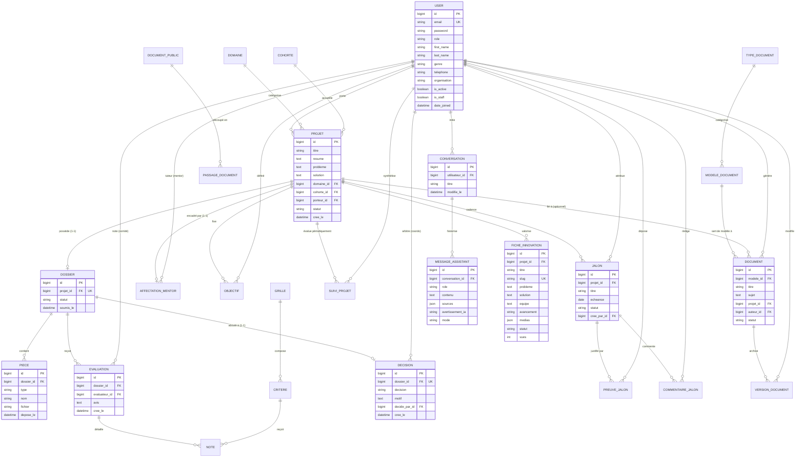

# Schéma de la Base de Données Relationnelle

> **Centre d'Innovation, d'Application et de Transfert — ISEP Amadou Traoré, Diamniadio**  
> **Auteur :** Lansana Coly (Lead technique) — Phase 3  
> **Référence :** Livrable Obligatoire N° 5 (Architecture des données, relations et contraintes d'intégrité)  
> **Document compagnon :** [`docs/dictionnaire_donnees.md`](../dictionnaire_donnees.md) (Dictionnaire exhaustif des 31 modèles)

---

## 1. Vue d'Ensemble et Principes de Modélisation

La base de données de la plateforme CIAT a été conçue selon les principes rigoureux de la **3ᵉ forme normale (3FN)** pour éliminer toute redondance anormale, garantir l'intégrité référentielle et offrir des performances d'interrogation optimales en environnement de production (PostgreSQL) et de test (SQLite en mémoire / disque).

### Principes architecturaux clés :
1. **Socle relationnel unifié :** L'entité centrale `core_projet` sert de clé d'interconnexion transverse entre les dossiers d'incubation, les affectations de mentors, les fiches publiques de la galerie, les documents administratifs générés et les indicateurs analytiques.
2. **Cloisonnement et intégrité par clé étrangère :**
   - Règle `on_delete=models.PROTECT` sur les suppressions d'utilisateurs référents, de domaines ou de modèles de documents pour interdire toute suppression en cascade accidentelle de données historiques.
   - Règle `on_delete=models.CASCADE` sur les entités purement subordonnées (ex. pièces jointes d'un dossier, notes d'une évaluation, versions d'un document, messages d'une conversation).
3. **Contraintes d'unicité métier (`UniqueConstraint`) :**
   - Une seule grille d'évaluation active sur l'ensemble de la plateforme (`condition=Q(active=True)`).
   - Une seule évaluation par couple `(dossier, evaluateur)` pour bannir les doubles votes.
   - Une seule note par critère par évaluation.
   - Une seule décision finale par dossier (`OneToOneField`).
   - Un seul bilan de suivi par échéance par projet (`unique_together = (projet, echeance)`).

---

## 2. Diagramme Entité-Association Global (Mermaid)

---

## 3. Détail des Relations et Règles d'Intégrité par Module

### 3.1 Cœur de Plateforme (`apps.core`)
1. `core_user` :
   - Clé primaire : `id` (`BigAutoField`).
   - Clé unique : `email` (`EmailField`).
   - Champ `genre` restreint aux valeurs canoniques (`F`, `H`, `A`) pour garantir des agrégations de parité exactes dans le tableau de bord.
2. `core_domaine` :
   - Les 7 pôles officiels du CIAT avec `slug` indexé pour filtrage instantané.
3. `core_cohorte` :
   - Promotions annuelles (`annee` entier court, dates de début et de fin).
4. `core_projet` :
   - Relations : `domaine_id` ➔ `core_domaine` (`PROTECT`), `cohorte_id` ➔ `core_cohorte` (`SET_NULL`), `porteur_id` ➔ `core_user` (`PROTECT`).
   - Statut contrôlé par énumération stricte : `idee` ➔ `depose` ➔ `selectionne` ➔ `incube` ➔ `prototype` ➔ `termine` (ou `rejete`).

### 3.2 Gestion de l'Incubateur (`apps.incubator`)
1. `incubator_dossier` :
   - Relation 1-to-1 stricte avec `core_projet` (`OneToOneField`, `CASCADE`).
   - Complétude calculée dynamiquement à partir des types de pièces obligatoires présentes (`fiche_projet`, `presentation_equipe`, `budget_previsionnel`).
2. `incubator_piece` :
   - Relation N-to-1 vers `incubator_dossier`.
   - Contrôle binaire à l'enregistrement : vérification de signature Magic Bytes (`%PDF-`, `PK\x03\x04` Word, images) et taille <= 10 Mo.
3. `incubator_grille` et `incubator_critere` :
   - Relation 1-to-N entre grille et critères.
   - Contrainte d'unicité conditionnelle sur `active=True` (désactivation automatique de la précédente lors de l'activation d'une nouvelle grille).
4. `incubator_evaluation` et `incubator_note` :
   - `incubator_evaluation` : Unicité sur `(dossier_id, evaluateur_id)`.
   - `incubator_note` : Unicité sur `(evaluation_id, critere_id)`. Moyenne pondérée calculée en temps réel.
5. `incubator_decision` :
   - Relation 1-to-1 avec `incubator_dossier`. Transition atomique du dossier et du projet associé lors de l'application de la décision (`accepte`/`refuse`).
6. Suivi opérationnel :
   - `AffectationMentor` (1-to-1 avec le projet, mentor obligatoire avec le rôle `mentor`).
   - `Objectif` et `Jalon` (liés au projet, calcul automatique du retard : `en_retard = statut != 'fait' and echeance < today`).
   - `PreuveJalon` et `CommentaireJalon` (liés au jalon).
   - `SuiviProjet` : Bilan périodique à 3 et 6 mois avec contrainte d'unicité `(projet_id, echeance)`.

### 3.3 Générateur de Documents Officiels (`apps.documents`)
1. `documents_typedocument` et `documents_modeledocument` :
   - Typologies administratives et gabarits avec sections ordonnées (`JSONField`), règles de charte et exemples de rédaction de référence pour le LLM.
2. `documents_document` et `documents_versiondocument` :
   - Chaque modification produit un enregistrement horodaté dans `VersionDocument` avec numéro incrémental (unicité sur `document_id, numero`).
   - Protection juridique : Le statut `valide` ou `publie` verrouille le document contre tout `PATCH` ultérieur (`409 Conflict`).

### 3.4 Assistant Conversationnel IA (`apps.assistant`)
1. `assistant_passagedocument` :
   - Découpage en passages textuels (chunks de 200 à 300 mots) rattachés aux `portal_documentpublic`.
   - Indexé pour la recherche lexicale avec lemmatisation, troncature et gestion des synonymes.
2. `assistant_conversation` et `assistant_messageassistant` :
   - Isolation stricte des conversations par utilisateur connecté (`utilisateur_id`).
   - Chaque message assistant archive le contenu, la liste validée des `sources` mobilisées (`document_id`, `titre`, `extrait`) et l'avertissement légal IA.

### 3.5 Galerie des Innovations (`apps.gallery`)
1. `gallery_ficheinnovation` :
   - Clé étrangère vers `core_projet`.
   - Champ `slug` unique pour l'URL publique `/galerie/{slug}`.
   - Cycle de vie : `brouillon` ➔ `en_validation` ➔ `publie` / `refuse`. Seules les fiches `publie` sont exposées publiquement.
   - Compteur `vues` atomiquement incrémenté via `F('vues') + 1`.

---

## 4. Indexation et Optimisation des Requêtes

Afin de garantir des des temps de réponse courts sur l'API REST (objectif, non encore mesuré) :
1. **Index de clés étrangères et filtres :**
   - Toutes les clés étrangères Django créent un index B-Tree par défaut.
   - Index explicites sur les champs de recherche textuelle et de filtrage fréquent : `slug`, `statut`, `echeance`, `publie_le`.
2. **Élimination du problème N+1 :**
   - Utilisation systématique de `.select_related("projet", "evaluateur", "domaine", "cohorte")` sur les relations One-to-One et Many-to-One.
   - Utilisation de `.prefetch_related("pieces", "notes__critere", "objectifs", "jalons")` sur les collections imbriquées.
3. **Agrégations SQL natives :**
   - Les indicateurs du tableau de bord (`apps.analytics`) et de complétude sont calculés en base via `Count()`, `Sum()`, `Q()` conditionnels, sans charger les objets en mémoire Python.
