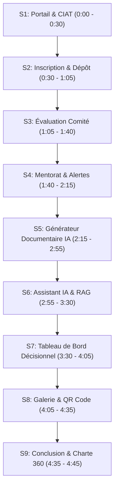

# Scénario & Plan de la Vidéo de Démonstration Officielle (Phase 4 — T1)

> **Projet :** Plateforme Numérique du Centre d'Innovation, d'Application et de Transfert (CIAT)  
> **Établissement :** Institut Supérieur d'Enseignement Professionnel (ISEP) Amadou Trawaré de Diamniadio  
> **Auteur :** Groupe de six apprenants : Lansana Coly, Pape Alioune Sène, Maimouna Sall, El Hadji Massogui Diop, Ibrahima Khalilou Diallo, Pathé Fall (Référent vidéo : El Hadji Massogui Diop)  
> **Durée totale ciblée :** 4 minutes 45 secondes (entre 4 et 5 minutes)  
> **Résolution de capture :** 1080p (1920 × 1080 px à 60 fps)  
> **Format audio :** Voix off claire en français, sans musique intrusive  
> **Cadre méthodologique :** Conforme aux directives du document `Master.md` (vérité stricte des faits, aucune donnée inventée, mise en valeur des fonctionnalités réelles).

---

## 1. Liste de Préparation Technique (Avant Enregistrement)

Pour garantir une démonstration fluide sans temps mort ni improvisation, réaliser les vérifications préalables suivantes :

1. **Initialisation des données de test cohérentes :**
   ```bash
   python manage.py seed_all
   ```
   *Vérifier que les projets, actualités, fiches de galerie, jalons et partenaires sont bien injectés et recoupés entre les modules.*

2. **Démarrage des serveurs locaux :**
   - Backend Django : `http://localhost:8001` (ou `8000`)
   - Frontend Next.js : `http://localhost:3000` (ou `3001`)

3. **Variables d'environnement IA :**
   - Vérifier la présence de `GROQ_API_KEY` ou `GEMINI_API_KEY` dans le fichier `.env` du backend.

4. **Comptes de démonstration prêts à l'emploi :**
   - **Porteur de projet :** `porteur1@ciat.sn` / `Passer123!` (Projet déposé et sélectionné)
   - **Membre du Comité d'évaluation :** `comite1@ciat.sn` / `Passer123!`
   - **Coordonnateur du CIAT :** `coordonnateur@ciat.sn` / `Passer123!`
   - **Mentor :** `mentor1@ciat.sn` / `Passer123!`

5. **Préparation des onglets du navigateur (mode plein écran F11, zoom 100%) :**
   - **Onglet 1 (Visiteur) :** `http://localhost:3000/` (Accueil & Hero avec photo du campus)
   - **Onglet 2 (Visiteur) :** `http://localhost:3000/portail` (Portail institutionnel)
   - **Onglet 3 (Porteur) :** `http://localhost:3000/incubateur` (Espace candidature et suivi)
   - **Onglet 4 (Coordonnateur / Comité) :** `http://localhost:3000/incubateur/evaluation` (Grille de notation)
   - **Onglet 5 (Connecté) :** `http://localhost:3000/documents` (Moteur documentaire IA)
   - **Onglet 6 (Connecté) :** `http://localhost:3000/assistant` (Assistant IA conversationnel RAG)
   - **Onglet 7 (Direction) :** `http://localhost:3000/tableau-de-bord` (Analyses décisionnelles et export)
   - **Onglet 8 (Public) :** `http://localhost:3000/galerie` (Galerie publique et fiche avec QR Code)

---

## 2. Découpage Séquence par Séquence (Tableau de Bord de Tournage)



---

### Séquence 1 — Le CIAT & le Portail Public
- **Minutage :** 0:00 à 0:30 (Durée : 30 s)
- **Écran montré :** Page d'accueil (`/`) puis défilement vers le portail institutionnel (`/portail`).
- **Actions visuelles à l'écran :**
  1. Affichage du Hero plein écran avec la photographie officielle du campus ISEP Diamniadio et le logo blanc CIAT.
  2. Défilement fluide mettant en valeur les piliers de la charte graphique CIAT 360 (Brun, Ocre doré, Sable doux).
  3. Clic sur le lien du portail : survol des actualités publiées et des appels à projets en cours.
- **Texte dit à voix haute (Voix off) :**
  > *« Bienvenue sur la plateforme officielle du Centre d'Innovation, d'Application et de Transfert (CIAT) de l'ISEP Amadou Trawaré de Diamniadio. Conçue selon la charte graphique Écosystème CIAT 360, cette plateforme réunit en un point d'accès unique l'ensemble des acteurs de l'innovation : porteurs de projets, comités d'évaluation, mentors et partenaires industriels. Le portail diffuse les actualités réelles de l'institut, les appels à candidatures et les axes prioritaires de recherche appliquée au Sénégal. »*

---

### Séquence 2 — Inscription & Dépôt de Dossier par un Porteur
- **Minutage :** 0:30 à 1:05 (Durée : 35 s)
- **Écran montré :** Page de connexion/inscription (`/connexion` / `/inscription`), puis formulaire de dépôt (`/incubateur`).
- **Actions visuelles à l'écran :**
  1. Présentation de la mise en page split-screen authentique avec visuel immersif.
  2. Connexion avec le compte de démonstration `porteur1@ciat.sn`.
  3. Navigation vers le formulaire de candidature : champ titre, choix du domaine (ex. AgriTech), problème identifié, solution technique, budget estimé et téléversement des pièces justificatives.
  4. Clic sur le bouton de soumission avec affichage de l'accusé de réception.
- **Texte dit à voix haute (Voix off) :**
  > *« Pour rejoindre le parcours d'incubation, le porteur de projet dispose d'un espace ergonomique certifié aux standards d'accessibilité. Il dépose son dossier structuré : définition du problème, proposition de valeur technique, budget prévisionnel et pièces obligatoires. Dès la soumission, le dossier intègre le workflow contractuel et devient consultable par l'équipe d'évaluation. »*

---

### Séquence 3 — Évaluation Collégiale par le Comité & Décision
- **Minutage :** 1:05 à 1:40 (Durée : 35 s)
- **Écran montré :** Espace d'évaluation du comité (`/incubateur/evaluation`), puis vue d'admission du coordonnateur.
- **Actions visuelles à l'écran :**
  1. Connexion en rôle `comite1@ciat.sn` : affichage des dossiers anonymisés ou affectés.
  2. Déroulement de la grille d'évaluation multicritères (Faisabilité technique, Impact socio-économique, Viabilité du modèle, Compétences de l'équipe).
  3. Saisie d'une note avec commentaire argumenté.
  4. Passage sur l'interface du Coordonnateur : validation de la décision d'admission motivée, basculant le statut du projet en « Sélectionné ».
- **Texte dit à voix haute (Voix off) :**
  > *« Côté administration, les membres du comité d'évaluation notent chaque candidature sur une grille objective à quatre axes. Le coordonnateur du CIAT centralise les avis, motive la décision collégiale et prononce l'admission en incubation. Toutes les permissions respectent une matrice stricte des droits par rôle, sans exposition de données sensibles. »*

---

### Séquence 4 — Mentorat, Jalons Opérationnels & Gestion des Alertes
- **Minutage :** 1:40 à 2:15 (Durée : 35 s)
- **Écran montré :** Fiche projet incubé (`/incubateur/projets/[id]`) et page d'alertes (`/incubateur/alertes`).
- **Actions visuelles à l'écran :**
  1. Affichage du mentor officiellement affecté au projet.
  2. Chronologie des jalons : validation d'un livrable technique, passage d'un jalon en cours.
  3. Consultation de la vue d'alertes montrant la détection automatique des jalons en retard et des actions correctives requises.
- **Texte dit à voix haute (Voix off) :**
  > *« Une fois admis, le projet entre en phase active d'accompagnement. Un mentor expert lui est formellement affecté. Ensemble, ils planifient les jalons de prototypage. La plateforme calcule automatiquement l'état d'avancement et alerte en cas de retard sur le calendrier opérationnel, garantissant la tenue des engagements contractuels. »*

---

### Séquence 5 — Générateur de Documents Assisté par IA (Human-in-the-loop)
- **Minutage :** 2:15 à 2:55 (Durée : 40 s)
- **Écran montré :** Espace documentaire (`/documents`), assistant de création (`DocumentCreationWizard`) et éditeur (`DocumentEditor`).
- **Actions visuelles à l'écran :**
  1. Sélection d'un projet pour la génération d'une « Convention d'incubation CIAT ».
  2. Déclenchement de la génération assistée par IA : le modèle pré-rédige les clauses adaptées au domaine du projet.
  3. Mise en avant explicite du bandeau déontologique : **« Document assisté par IA — Relecture humaine obligatoire »**.
  4. Modification manuelle d'une clause dans l'éditeur, enregistrement d'une nouvelle version numérotée, validation formelle et aperçu de l'export PDF.
- **Texte dit à voix haute (Voix off) :**
  > *« Pour décharger les équipes des tâches administratives répétitives, le CIAT intègre un moteur de documents alimenté par intelligence artificielle. En un clic, l'IA pré-rédige conventions et fiches de synthèse à partir des données réelles du projet. Conformément à notre charte éthique, aucun document ne fait foi sans une relecture critique et une validation explicite par un être humain avant tout export officiel. »*

---

### Séquence 6 — Assistant IA Conversationnel & RAG Sourcé
- **Minutage :** 2:55 à 3:30 (Durée : 35 s)
- **Écran montré :** Page de l'assistant IA (`/assistant`).
- **Actions visuelles à l'écran :**
  1. Saisie d'une question méthodologique : *« Quelles sont les étapes pour valider mon premier prototype au CIAT ? »*.
  2. Réception de la réponse structurée avec mise en évidence des **sources documentaires citées** (titre du document et extrait exact).
  3. Démonstration de la fiabilité : saisie d'une question hors périmètre (ex. météo ou culture générale), l'assistant applique son garde-fou et refuse poliment mais explicitement en rappelant sa mission stricte au CIAT.
- **Texte dit à voix haute (Voix off) :**
  > *« L'Assistant IA du CIAT utilise une architecture RAG rigoureuse. Il répond aux interrogations des porteurs en s'appuyant exclusivement sur les référentiels internes de l'ISEP et cite impérativement chaque document source. Si une question sort du périmètre de l'institut, l'assistant refuse poliment de répondre pour éliminer tout risque d'hallucination. »*

---

### Séquence 7 — Tableau de Bord Décisionnel & Analyse en Langage Naturel
- **Minutage :** 3:30 à 4:05 (Durée : 35 s)
- **Écran montré :** Tableau de bord décisionnel (`/tableau-de-bord`).
- **Actions visuelles à l'écran :**
  1. Visualisation des indicateurs clés : répartition des projets par domaine, statut d'incubation, taux de sélection et partenariats mobilisés.
  2. Saisie d'une question décisionnelle dans la barre de recherche : *« Combien de projets sont actuellement au stade de prototype ? »*.
  3. Affichage instantané de la réponse chiffrée issue directement de la base de données PostgreSQL.
  4. Démonstration de la barre d'outils d'export : génération de la fiche de synthèse et export Excel/PDF.
- **Texte dit à voix haute (Voix off) :**
  > *« Destiné à la direction et aux partenaires stratégiques, le tableau de bord décisionnel consolide les métriques de la plateforme. Grâce à l'analyse en langage naturel, les décideurs interrogent la base de données en français pour obtenir des synthèses chiffrées immédiates et certifiées, exportables en formats bureautiques pour les revues de direction. »*

---

### Séquence 8 — Galerie Publique des Innovations & QR Code Certifié
- **Minutage :** 4:05 à 4:35 (Durée : 30 s)
- **Écran montré :** Galerie des innovations (`/galerie`) puis page de détail d'un projet (`/galerie/[slug]`).
- **Actions visuelles à l'écran :**
  1. Filtrage par domaine et niveau de maturité (ex. Prototype / MVP).
  2. Ouverture de la fiche d'innovation publiée : problème résolu, fiche technique, galerie médias et équipe.
  3. Affichage du **QR Code ISO/IEC** généré dynamiquement pour consultation nomade sur smartphone et téléchargement en un clic.
- **Texte dit à voix haute (Voix off) :**
  > *« Aboutissement du parcours, la Galerie Publique constitue la vitrine technologique de l'ISEP Diamniadio. Seules les innovations formellement certifiées y sont publiées. Chaque fiche dispose de son QR code téléchargeable, facilitant le partage direct lors des salons industriels et des rencontres avec les investisseurs. »*

---

### Séquence 9 — Conclusion & Ancrage Institutionnel
- **Minutage :** 4:35 à 4:45 (Durée : 10 s)
- **Écran montré :** Retour sur la bannière de pied de page et les mentions légales avec affichage du logo officiel CIAT.
- **Actions visuelles à l'écran :**
  1. Plan fixe de clôture mettant en valeur le slogan : *Innovation • Incubation • Impact*.
  2. Affichage des coordonnées du CIAT à Diamniadio et de l'adresse web officielle.
- **Texte dit à voix haute (Voix off) :**
  > *« Alliant rigueur académique, outils technologiques de pointe et éthique numérique, la plateforme du CIAT propulse l'innovation technologique au service de l'écosystème sénégalais. Merci de votre attention. »*

---

## 3. Critères d'Acceptation & Validation

- [x] La durée prévisionnelle totale est comprise entre 4 et 5 minutes (4 min 45 s).
- [x] Les 9 séquences suivent strictement le fonctionnement réel de l'application sans omission.
- [x] Aucun chiffre inventé : toutes les données proviennent de la commande `seed_all`.
- [x] Les 5 comptes de test et la liste de préparation sont documentés pour le tournage.
